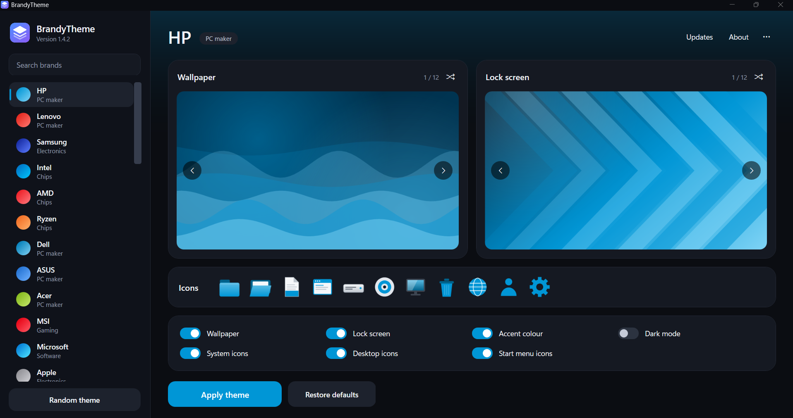
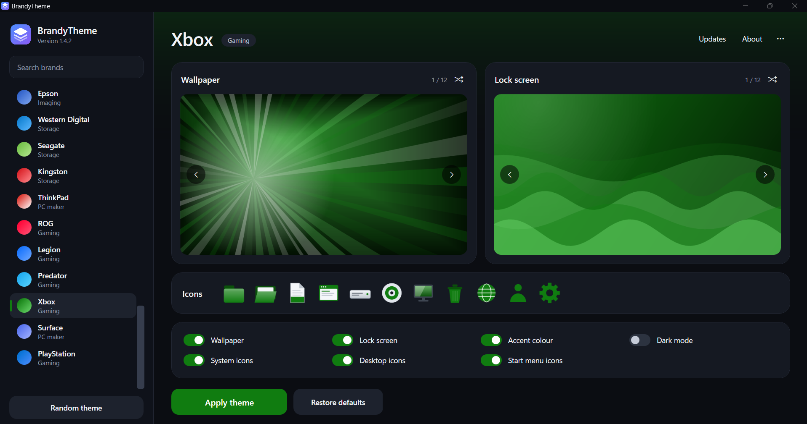

# BrandyTheme

Brand themes for Windows 10 and 11: wallpapers, lock screens, accent colours and system icons for
**40 brands** - HP, Lenovo, Samsung, Intel, AMD, Ryzen, Dell, ASUS, Acer, MSI, Microsoft, Apple, NVIDIA,
GeForce, Radeon, Razer, Alienware, Gigabyte, Logitech, Corsair, Sony, LG, Toshiba, Huawei, Xiaomi, Google,
Qualcomm, Snapdragon, Canon, Epson, Western Digital, Seagate, Kingston, ThinkPad, ROG, Legion, Predator,
Xbox, Surface and PlayStation.

  
  

## Install / update / uninstall

1. Extract the zip.
2. Double-click **Install BrandyTheme.cmd**, accept the UAC prompt and choose
   **1** Install (or Update when already installed), **2** Uninstall, **3** Exit.
3. Open **BrandyTheme** from the Start menu.

Switches skip the menu: `/install`, `/update`, `/uninstall`, `/silent`.

## Wallpapers and lock screens

Clean colour artwork - no text, no logos. Every brand has **12 wallpapers and 12 lock screens (960 images)**
and none of them repeat: a brand's 12 variants walk through all 12 art styles (Glow, Waves, Rings, Hex,
Circuit, Triangles, Stripes, Grid, Bokeh, Burst, Dots, Chevrons), each in one of 6 palettes built from the
brand's own colours, with different sizes and positions every time. Lock screens start half-way round the
list, so a brand's wallpaper and lock screen never match.

## Icons

**System icons** change, for every user: the generic file, folder, open-folder, application, drive, network
and disc icons, plus the icon of every drive letter (C:, D:, USB, DVD...). **Your folders** - Desktop,
Documents, Downloads, Music, Pictures and Videos - get their own themed icons. **Desktop icons**
(This PC, Recycle Bin, Network, User Files, Control Panel) and **Start menu icons** (program folders) are
themed too. After applying, Explorer restarts for a moment so Windows reloads its icons.

Windows keeps a few things on its own icons and does not allow them to be replaced safely: the built-in
system folders (Program Files, Windows, Users, ProgramData), the Settings app, and the icon of each
installed app (it belongs to the program). Everything else follows the theme.

## Updates (version.txt)

Keep these two files in the root of the `main` branch of github.com/tasmon/BrandyTheme:

| File | Content |
|---|---|
| `version.txt` | the latest version on the first line, e.g. `1.5.1` |
| `BrandyTheme.ps1` | the latest script |

To release: raise `$script:AppVersion` in `BrandyTheme.ps1`, put the same number in `version.txt`, commit and
push both. The app checks `version.txt` at start-up (switch in the ••• menu), checks the download is a valid
script of that version, then restarts on it. Optional: put the file's SHA-256 on line 2 of `version.txt`.

## If something goes wrong

Problems are shown in a message and saved to `C:\ProgramData\BrandyTheme\error.log`
(`app.log` shows how far start-up got, `crash.log` comes from the launcher).

## Known limits

- The Settings app, Start tiles and taskbar app icons are protected by Windows and cannot be re-themed.
  The accent colour (with dark mode) colours Start and the taskbar.
- Lock screen theming works on Pro, Enterprise and Education; Windows Home may ignore it.
- Per-user settings go to the account that approved the UAC prompt.
- Brand names are trademarks of their owners; this project is not affiliated with them.

---

**Created by Tasmon Islam** - [tasmon@outlook.com](mailto:tasmon@outlook.com) - [github.com/tasmon](https://github.com/tasmon)
